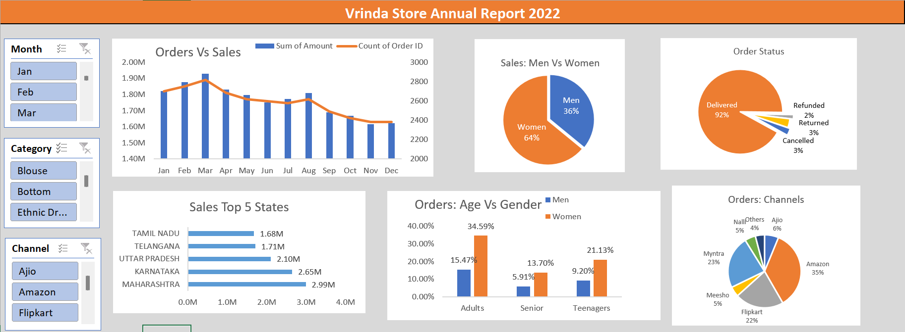

# Vrinda Store | Annual Sales Analysis 2022

  

## Project Overview
Vrinda Store wanted to review its 2022 performance, understand customer purchasing patterns, and identify opportunities to increase sales in 2023. I analyzed its sales dataset using **Microsoft Excel**, prepared summary reports using **PivotTables and PivotCharts**, and built an **interactive dashboard with slicers**.

## Business Questions
1. How do monthly sales and order volumes compare?
2. Which month had the highest sales and transaction volume?
3. How do sales differ between women and men?
4. What is the distribution of fulfillment statuses?
5. Which states generate the most revenue?
6. How do age group and gender relate to purchases?
7. Which channels account for the greatest transaction volume?
8. Which product categories generate the most revenue?

## Dashboard


> The screenshot is a preview. The original Excel workbook contains interactive PivotCharts and slicers. It is intentionally **not included** in this public-ready package because the uploaded workbook contains customer IDs, order identifiers, and shipping-related fields. Publish a reviewed/redacted version only after checking the dataset's sharing rights and pivot caches.

## Tools & Techniques
- **Microsoft Excel:** data preparation, analysis, and visualization
- **Data processing:** prepared Month and Age Group fields for reporting (the `Month` field contains the Excel `TEXT(date,"mmm")` formula; age-group assignment logic should be documented/confirmed before claiming specific thresholds)
- **PivotTables:** aggregated sales amount and transaction counts by month, gender, status, state, age group, and channel
- **PivotCharts:** compared category performance and order trends
- **Slicers:** interactive filters for Month, Category, and Channel

**Workbook evidence:** eight sheets, including the main data worksheet, six summary/PivotTable sheets, and the report dashboard; six PivotTable definitions, twelve chart objects, and three slicers.

## Headline KPIs
| KPI | 2022 Result |
|---|---:|
| Recorded sales (sum of Amount) | **₹21,176,377** |
| Transaction / order-line rows | **31,047** |
| Distinct Order IDs | **28,471** |
| Highest-revenue month | **March — ₹1,928,066** |
| Highest transaction-count month | **March — 2,819 rows** |
| Delivered transaction rows | **28,641 (92.25%)** |
| Top-selling category by revenue | **Set — ₹10,507,546** |

**Metric definition:** PivotTable `Count of Order ID` counts nonblank Order ID **rows**, not distinct orders. The source has 31,047 rows and 28,471 distinct Order IDs. Avoid interpreting row-based counts as distinct customer purchases. Revenue is the sum of the supplied `Amount` column, without an independently verified net-of-returns adjustment.

## Key Insights

### 1. Sales and transaction trends
- **March** leads both recorded revenue (**₹1,928,066**) and transaction rows (**2,819**).
- **November** has the lowest monthly revenue (**₹1,615,356**) and transaction rows (**2,383**).
- See [`monthly_sales.csv`](data/aggregated/monthly_sales.csv).

### 2. Customer segments
- **Women:** ₹13,562,773 (**64.05%** of recorded sales).
- **Men:** ₹7,613,604 (**35.95%**).
- The workbook's **Adults** segment accounts for **15,543 of 31,047 rows (50.06%)**. This is a dataset-provided label; age band cutoffs require validation.

### 3. Geographic performance
The top five revenue-contributing states are:

| Rank | State | Sales (INR) |
|---:|---|---:|
| 1 | Maharashtra | 2,990,221 |
| 2 | Karnataka | 2,646,358 |
| 3 | Uttar Pradesh | 2,104,659 |
| 4 | Telangana | 1,712,439 |
| 5 | Tamil Nadu | 1,678,877 |

See [`top_10_states.csv`](data/aggregated/top_10_states.csv) for the top ten.

### 4. Channels and fulfillment
- By **transaction rows**, Amazon accounts for **35.48%**, Myntra **23.36%**, and Flipkart **21.59%**. Together: **80.44%**.
- **Delivered:** 28,641 rows (**92.25%**); **Returned:** 1,045 (**3.37%**); **Cancelled:** 844 (**2.72%**); **Refunded:** 517 (**1.67%**).
- Channel shares are **not revenue shares**; the channel PivotTable uses `Count of Order ID`.

### 5. Product-category performance
- **Set** is the largest sales category at **₹10,507,546** (~49.62% of recorded revenue).
- **Kurta** follows at ₹4,959,377; **Western Dress** at ₹3,148,836.
- See [`category_sales.csv`](data/aggregated/category_sales.csv).

## Recommendations for 2023
1. **Prioritize promising customer segments:** test campaigns for adult women, with eligibility and age-group definitions validated before targeting.
2. **Concentrate geographic experiments:** test offers in Maharashtra, Karnataka, and Uttar Pradesh, while measuring incremental revenue rather than assuming historical performance guarantees growth.
3. **Optimize marketplace presence:** trial promotions on Amazon, Myntra, and Flipkart, then compare revenue, fees, conversion rates, and returns—not only transaction counts.
4. **Leverage strong categories:** improve assortment, stock planning, and merchandising for Sets, Kurtas, and Western Dresses.
5. **Monitor fulfillment:** investigate cancellations and returns by product and channel, and track improvements over time.

## Data Quality & Limitations
- **31,047 source rows**, all dated **2022**, with no empty fields in the 20 inspected business columns (B:U) according to the workbook's stored cell values.
- **2,576 repeated Order ID occurrences** beyond the first occurrence of each ID; these may be legitimate multiple order lines. They are **not evidence of erroneous duplicate records**.
- The workbook has an `Age Group` column; its derivation was not fully verified. Do not claim exact age boundaries based only on the summary chart.
- The workbook includes formula-backed `Month` cells, PivotTables, charts, and slicers. The analysis supports **processing and aggregation**; precise cleaning actions (such as duplicate removal, null replacement, or standardization rules) cannot be proven solely from the final workbook.
- The data does not establish profitability, customer lifetime value, causality, or the 2023 outcome.
- See [Data validation notes](docs/data_validation.md).

## Repository Structure
```text
Vrinda-Store-Sales-Analysis-2022/
├── README.md
├── dashboard/
│   └── vrinda_store_dashboard.png
├── data/
│   └── aggregated/
│       ├── monthly_sales.csv
│       ├── sales_by_gender.csv
│       ├── order_status.csv
│       ├── top_10_states.csv
│       ├── channel_distribution.csv
│       ├── category_sales.csv
│       └── age_group_distribution.csv
├── docs/
     └── data_validation.md
```

## How to Explore
View the preview above and open CSV files under `data/aggregated/`. The public version intentionally includes **aggregated non-customer-level data**. If you can securely produce and share a public-safe Excel workbook, add it under `excel/` and link it here.


